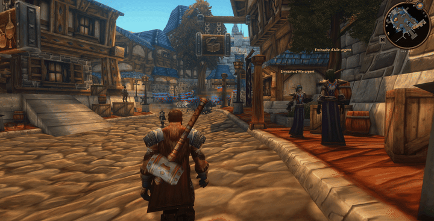

# Cinematic Azeroth

<!-- Download badge for CurseForge project 1809957, served by shields.io. -->

**Press one key and Azeroth becomes a film.** The whole interface and the nameplates disappear, and black letterbox bars slide in from the top and bottom of the screen. Ride through a zone, watch a sunset over the sea, take a flight, take screenshots. Press the key again, or Escape, and everything comes back.

Made for **World of Warcraft: Forever**.

<!-- Once the GIF is committed (see gallery/README.md):
 -->

## What it does

- **Hides everything, safely.** Your key runs Blizzard's own Toggle UI, the one on Alt+Z, so it works in combat too and every window closes and reopens with the game's own code.
- **Choose what else goes:** nameplates (Threat Plates included), the names above heads, speech bubbles, combat numbers, and the interaction icons over NPCs and the fishing bobber. The game settings changed for this are put back exactly as they were afterwards, even after a crash.
- **Keeps what you need over the scene:**
  - the windows an NPC opens: dialog and quests, loot, vendors, flight master, trainers, bank, mail, auction house and more, with their confirmation pop-ups;
  - your bags, opened with your bag key or by a vendor;
  - the ! and ? over quest givers;
  - tooltips, if you want them.
- **Talk without leaving it:** keep the speech bubbles, and the chat typing bar shows while you type, then fades out.
- **Combat:** cinematic mode ends as a fight starts and comes back 3 seconds after it.
- **Flights:** taking a flight master's flight turns cinematic mode on, landing turns it off.
- **Letterbox bars to taste:** height, buttons for the 2.39:1, 2.00:1 and 1.85:1 film formats on your screen, slide time, and a preview.
- **Bonus fix:** the minimap's mail envelope comes back after the interface has been hidden, instead of staying hidden until new mail arrives.

## Quick start

1. Type **/cinema**.
2. Click the key button under "Your key", then press the key (or mouse button) you want.
3. Press it in the game. Press it again, or Escape, to come back.

Every option is on that page, also under Options > AddOns > Cinematic Azeroth.

## Good to know

- **Alt+Z** still hides the interface without bars, unless you tick the option to add them there too.
- **Combat and flights:** no key is pressed then, so the addon shows or hides the interface itself. If errors mentioning Cinematic Azeroth appear after a fight or a flight, untick those options and use your key.
- **During combat** the game doesn't let addons change the name, nameplate and icon settings: in a cinematic mode started during a fight, those go when the fight ends.
- **Better Fishing:** its icon over the bobber stays hidden in cinematic mode, and its key still catches the fish.
- **DynamicCam:** if its "Taxi" situation hides the interface, keep only one of the two for flights.

## Commands

- **/cinema**: options
- **/cinema test**: shows the bars for 3 seconds
- **/cinema debug**: saves what is on screen, for a bug report
- **/cinema watch**: more diagnostics, off by default
- **/cinema help**: every command

## Credits

By **Malven31**, made with Claude (Anthropic).

Licence: MIT.

## Feedback

Report bugs and suggest features in the comments on this page, or on GitHub. For a bug, type /cinema debug while it shows, then /reload, and mention it: the details are saved in your SavedVariables folder, in CinematicAzeroth.lua.

Source code and issue tracker: [github.com/Malven31/cinematic-azeroth](https://github.com/Malven31/cinematic-azeroth)
